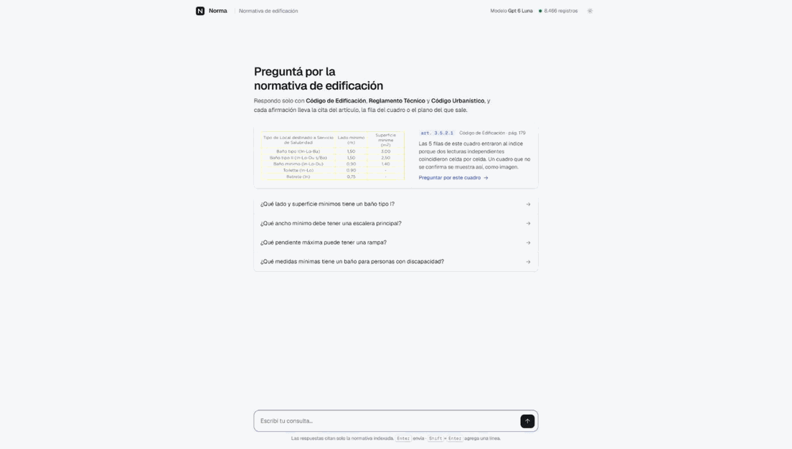
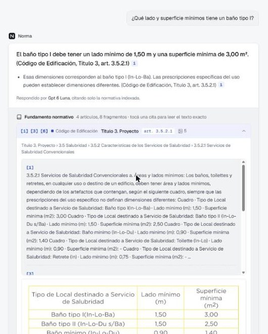
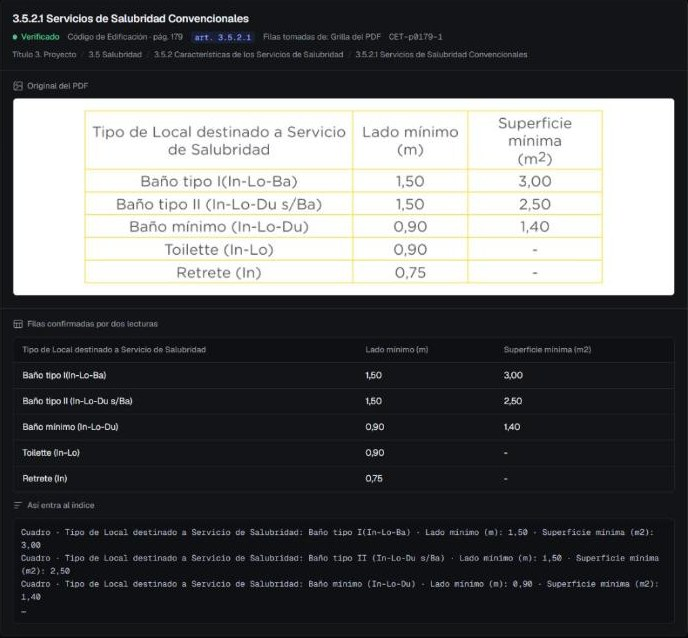
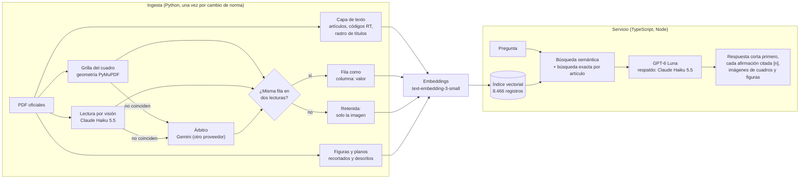
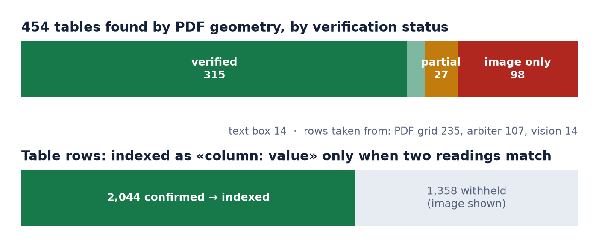
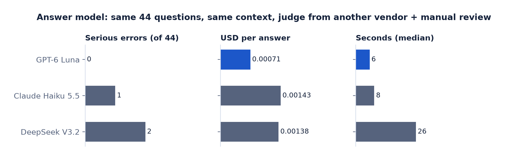
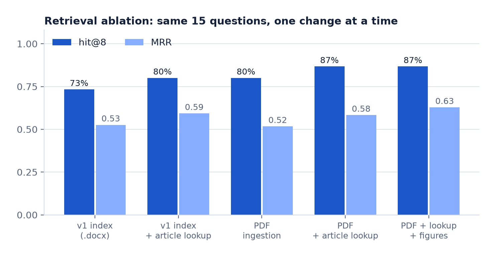
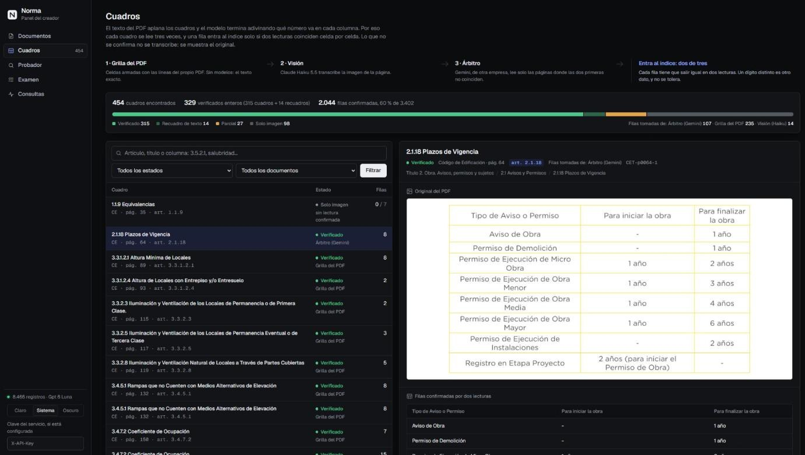
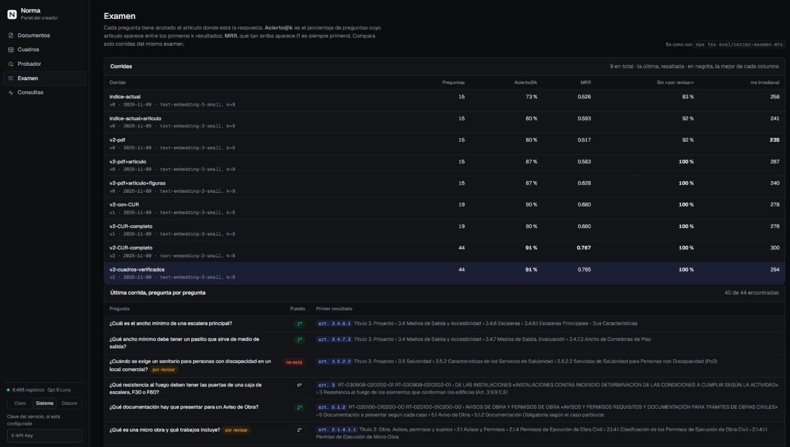

# Norma: un agente con fuentes para la normativa de edificación

[](../../actions/workflows/ci.yml)

Norma responde preguntas sobre el código de edificación y el código urbanístico de una ciudad, en castellano, y cita el artículo, la fila de cuadro o el plano exacto que respalda cada afirmación. Está en producción en un estudio de arquitectura y gestoría de habilitaciones, dentro de la plataforma interna del estudio.

**Mi rol:** lo construí y lo opero yo solo: la ingesta, la evaluación, el servidor del agente, el panel de trabajo y el despliegue, trabajando directamente con el estudio sobre cómo tiene que ser una respuesta. Cada número de este documento enlaza a la corrida o al resumen versionado del que sale ([docs/measurements.md](docs/measurements.md)).

*English version: [README.md](README.md)*



*El cuadro de baños cuyas columnas un modelo invirtió en producción: ahora se lee tres veces, 2.044 de 3.402 filas de cuadros quedan confirmadas por dos lecturas independientes y el resto se retiene en lugar de adivinarse. [Probalo en dos minutos](#probalo-en-dos-minutos).*

Lo difícil no es el chat. Lo difícil es que la norma vive en unas 3.800 páginas de PDF llenas de cuadros con encabezados en dos niveles, planos escaneados y texto rotado. Un modelo que lee mal un cuadro da una respuesta de habilitación equivocada. Este repo trata, sobre todo, de volver confiable la entrada y de demostrarlo con mediciones.

## En una mirada

| | |
|---|---|
| **Corpus** | 3 cuerpos normativos: Código de Edificación (CE, 492 páginas), Reglamentos Técnicos (RT, 1.462 páginas) y Código Urbanístico (CUR, 10 PDF, 1.811 páginas) |
| **Índice** | 8.466 registros: fragmentos por artículo, 514 figuras y planos, y filas de cuadros escritas como `columna: valor` |
| **Cuadros** | 454 cuadros encontrados por la geometría del PDF. 2.044 de 3.402 filas (60 %) confirmadas por dos lecturas independientes; el resto se retiene y se muestra como imagen ([resumen](eval/resultados/tablas-verificacion.json)) |
| **Búsqueda** | Examen de 44 preguntas: artículo correcto entre los 8 primeros en 40/44 (91 %), MRR 0,765. Preguntas escritas por mí a partir de los artículos; todavía no las revisó un arquitecto |
| **Respuestas** | Modelo elegido sobre las mismas 44 preguntas, con un juez de otro proveedor y revisión a mano: 0 errores graves, USD 0,0007 y 6 s por respuesta |
| **Costo** | Toda la ingesta, experimentos incluidos, costó unos USD 7 en llamadas a la API. Cada script pago tiene un tope de gasto |
| **Producción** | Docker en un PaaS propio, autenticación por clave, modelo principal y de respaldo de dos proveedores, registro de consultas y de valoraciones, panel de trabajo |

## Cómo se ve

| La respuesta, con su fuente | El mismo cuadro en el panel |
|---|---|
|  |  |
| «Lado 1,50 m, superficie 3,00 m²» para un baño tipo I: los valores que un modelo llegó a invertir ([caso](docs/case-study-tables.md)). Ocho fragmentos recuperados se agrupan en cuatro artículos, cada uno con sus números de cita, y los planos debajo. | El cuadro detrás de esa respuesta: verificado por la grilla del PDF y la lectura por visión, el recorte original y la línea exacta que entró al índice. |

## Cómo funciona



## Decisiones de ingeniería, con la evidencia

### 1. Los cuadros se verifican, no se confían

**El incidente.** En producción, el modelo de respuesta dijo que un baño tipo I necesita «1,50 m² y un lado mínimo de 3,00 m». El código dice lo contrario: lado 1,50 m, superficie 3,00 m². La causa no era el modelo. La capa de texto del PDF aplana los cuadros (`Lado mínimo mínima (m) (m 2) Baño tipo I 1,50 3,00`), así que cualquier modelo tiene que adivinar qué número va con qué columna. Otro modelo había fallado igual con la resistencia al fuego de las puertas de escalera.

**La solución.** Cada cuadro se lee de tres maneras independientes:

1. **Grilla:** los bordes de las celdas salen de las líneas del propio PDF (PyMuPDF), sin modelos.
2. **Visión:** Claude Haiku 5.5 transcribe la imagen de la página.
3. **Árbitro:** Gemini, de otro proveedor, lee solo las páginas donde las dos primeras no coinciden.

Una fila entra al índice solo si dos lecturas coinciden celda por celda. La normalización cubre comas decimales, superíndices y cortes de palabra; un dígito distinto nunca se tolera. Cada valor lleva el nombre de su columna: `Cuadro · Lado mínimo (m): 1,50 · Superficie mínima (m2): 3,00`. Las filas no confirmadas **no** se escriben como texto: el fragmento dice que el cuadro no pudo verificarse y la interfaz muestra el recorte del cuadro, así el modelo no puede adivinar. El troceo nunca parte una fila de cuadro.



**Resultado.** 2.044 filas confirmadas y 98 cuadros que quedan solo como imagen. El examen de búsqueda no se movió (40/44). Las dos preguntas que habían fallado se hicieron 3 veces a cada modelo: los valores estuvieron bien en las 12 respuestas (un control a mano; esas respuestas no se guardaron). Costo: USD 0,81 entre visión y árbitro ([resumen](eval/resultados/tablas-verificacion.json)).

El caso completo, del error en producción a la solución: [docs/case-study-tables.md](docs/case-study-tables.md).

La lógica y sus casos borde tienen pruebas unitarias armadas con las fallas reales: columnas invertidas, texto rotado leído al revés, celdas combinadas y encabezados heredados ([`tests/test_cuadros.py`](tests/test_cuadros.py)). Código: [`ingest_v2/tablas_pdf.py`](ingest_v2/tablas_pdf.py).

### 2. Ingerir el PDF, no el formato cómodo

La versión 1 indexaba los `.docx`. Pierden estructura: sin números de artículo en los títulos, sin códigos RT, cuadros sin grilla. La versión 2 lee los PDF oficiales:

- los códigos RT salen del encabezado de cada página;
- el rastro de artículos se encadena por número y se nombra con los marcadores del PDF;
- encabezados y pies se recortan por geometría;
- las hojas de firmas se descartan.

Se encontraron en el texto los 736 artículos numerados del Código de Edificación (736/736). Código: [`ingest_v2/extraer_pdf.py`](ingest_v2/extraer_pdf.py).

### 3. Cada elección de modelo se mide

- **Visión:** 8 modelos sobre las mismas páginas, puntuados automáticamente contra la capa de texto del PDF y una extracción de cuadros contrastada. Claude Haiku 5.5 empató con el mejor en calidad, también en la peor página, a 1/12 del costo del modelo anterior.
- **Respuestas:** 3 candidatos respondieron las mismas 44 preguntas con el mismo contexto. Controles automáticos, un juez de otro proveedor y cada error marcado revisado a mano. GPT-6 Luna tuvo 0 errores graves y fue el más barato y rápido; Claude Haiku 5.5 es el respaldo de otro proveedor.



Scripts: [`eval/comparar_modelos_vision.py`](eval/comparar_modelos_vision.py) y [`eval/comparar_modelos_respuesta.mts`](eval/comparar_modelos_respuesta.mts). Detalle: [docs/measurements.md](docs/measurements.md#answer-model-three-candidates-on-the-same-44-questions).

### 4. Un examen controla cada cambio

[`eval/correr-examen.mts`](eval/correr-examen.mts) hace preguntas cuyo artículo esperado se conoce e informa acierto@k y MRR. Cada resultado queda versionado en [`eval/resultados/`](eval/resultados/):

| Cambio | Examen | Acierto@8 | MRR |
|---|---|---|---|
| Índice v1 (`.docx`) | v0, 15 p. | 11/15 | 0,526 |
| Ingesta desde PDF + búsqueda exacta por artículo + figuras | v0, 15 p. | 13/15 | 0,628 |
| + Código Urbanístico | v1, 19 p. | 17/19 | 0,68 |
| Examen ampliado a 44 preguntas | v2, 44 p. | 40/44 | 0,767 |
| Cuadros verificados en lugar de texto aplanado | v2, 44 p. | 40/44 | 0,765 |



La ingesta desde PDF sola no subió el MRR: la mejora llegó cuando los números de artículo que recuperó se usaron para la búsqueda exacta. Los gráficos salen de los resultados versionados con [`eval/graficos.py`](eval/graficos.py).

Las 4 que todavía fallan están explicadas una por una en [docs/measurements.md](docs/measurements.md#the-4-misses). Dos son dudas para un arquitecto, no fallas de búsqueda.

El examen también corre en el CI, sin claves de API. Las 10 preguntas cuya respuesta está en la muestra de la demo se guardan con sus vectores ya calculados ([`demo/examen/`](demo/examen/)), y [`tests/examen-muestra.test.ts`](tests/examen-muestra.test.ts) frena el build si el acierto@8 o el MRR de la muestra bajan de los 8/10 y 0,80 de hoy. Es un control de regresión sobre un recorte chico, no la cifra principal.

### 5. Citas que un profesional puede verificar

Primero la respuesta, en una a tres oraciones. Después el detalle, donde cada afirmación lleva una cita `[n]` a una ubicación legal, nunca a un nombre de archivo: «Código de Edificación, art. 3.5.2.1». Las figuras, planos e imágenes de cuadros vinculados al artículo citado se muestran junto a la respuesta. El prompt de sistema prohíbe responder de memoria y pide decir cuándo la norma recuperada no cubre la pregunta.

### 6. Hecho para operarse

- `/panel` es el panel de trabajo, con cinco pestañas:
  - **Documentos:** explorador de fragmentos por archivo de origen.
  - **Cuadros:** cada uno de los 454 cuadros con su estado, la lectura que ganó, las filas confirmadas y el recorte original, más el texto exacto que entró al índice.
  - **Probador:** qué devuelve la búsqueda para una pregunta, sin generar.
  - **Examen:** cada corrida, y la última pregunta por pregunta.
  - **Consultas:** el registro de preguntas reales.

| Pestaña Cuadros | Pestaña Examen |
|---|---|
|  |  |

- Cada consulta y cada 👍/👎 queda registrada.
- Cambiar de modelo es una variable de entorno. El respaldo entra cuando el principal no logra empezar a transmitir, y está probado.
- El CI corre la verificación de tipos, las pruebas unitarias y el examen de búsqueda sobre la muestra; nada de eso llama a una API.
- La jurisdicción es configuración, no código: la ciudad, los nombres de sus códigos, cómo se cita cada uno y el bloque de corpus del prompt viven en [`jurisdicciones/<id>/`](jurisdicciones/README.md) y se eligen con `JURISDICCION`. El servicio no arranca sin una, `/health` informa cuál cargó, y una prueba compara cada jurisdicción con su prompt guardado (`prompt.snapshot.txt`): pasar la de producción a configuración no cambió ni un byte de lo que ve el modelo.

## Límites, sin maquillaje

- Las preguntas del examen se escribieron a partir de los artículos, pero todavía no las revisó un arquitecto. Los números orientan decisiones; no son una certificación.
- 98 cuadros no pudieron confirmarse con dos lecturas y se sirven solo como imagen. Es deliberado: un valor equivocado es peor que ningún valor.
- La comparación de modelos de respuesta usó un solo juez y 44 preguntas.
- El índice vive en memoria (unos 8.500 registros, así que la búsqueda por coseno es instantánea). Pasar a pgvector solo toca [`src/lib/vector-store.ts`](src/lib/vector-store.ts).

## Mapa del repo

```
ingest_v2/        ingesta de los PDF (Python): texto, cuadros, figuras, Código Urbanístico, indexado
src/              servicio (TypeScript): búsqueda, prompt, generación, API HTTP
  lib/            embeddings, generación con respaldo, índice vectorial
public/           chat y panel de trabajo (sin frameworks)
jurisdicciones/   ciudad, nombres de los códigos y reglas de cita: configuración, no código
eval/             exámenes, comparaciones de modelos, resultados versionados
tests/            pruebas unitarias (sin llamadas a API)
docs/             mediciones, el caso de los cuadros, sistema de diseño, imágenes
demo/             una muestra del índice real y `npm run demo`
scripts/          rearmar la muestra, guardar la foto del prompt
```

## Probalo en dos minutos

El repo trae una muestra chica del índice real en [`demo/data`](demo/data): los capítulos del Código de Edificación sobre salidas y escaleras (3.4) y sobre baños (3.5). Son 282 registros con sus embeddings ya calculados, más 15 cuadros con sus imágenes originales. Para arrancar no hace falta ninguna clave:

```bash
npm install
npm run demo                      # chat en http://localhost:8787, panel en /panel
```

Sin claves, el panel funciona entero: documentos, los 15 cuadros con sus lecturas, las corridas del examen y el registro de consultas. Para preguntarle al chat, poné una clave de OpenAI (para el embedding de la pregunta) y una de OpenRouter (para la respuesta) en `.env.local` (copiá `.env.example`) y preguntá *«¿Qué lado y superficie mínimos tiene un baño tipo I?»*; después abrí la pestaña Cuadros. Una pregunta cuesta bastante menos de un centavo de dólar. La muestra se rearma desde un índice completo con `python -I scripts/muestra.py <índice>`.

## Correrlo sobre el corpus completo

Hace falta Node 22, Python 3.11+ (`pip install -r requirements.txt`) y claves de OpenAI (embeddings) y OpenRouter (generación) en `.env.local` (ver `.env.example`). Los PDF de la norma y el índice generado no se versionan.

```bash
npm install && pip install -r requirements.txt
export JURISDICCION=jurisdicciones/ejemplo          # nombres de los PDF de origen, reglas de cita

# Cuadros: tres lecturas, y quedan las filas en las que coinciden dos (topes de gasto en USD)
python -I ingest_v2/tablas_pdf.py geometria <carpeta con los PDF>
python -I ingest_v2/tablas_pdf.py vision <carpeta con los PDF> 0.50
python -I ingest_v2/tablas_pdf.py arbitro <carpeta con los PDF> 0.50
python -I ingest_v2/tablas_pdf.py decidir <carpeta con los PDF>

# Texto y figuras del Código de Edificación y los RT; después el Código Urbanístico
python -I ingest_v2/extraer_pdf.py <carpeta con los PDF> data/v2/chunks.jsonl
python -I ingest_v2/extraer_figuras.py <carpeta con los PDF> --describir 2.00
python -I ingest_v2/extraer_cur.py <carpeta del CUR> --prosa 0.30 --tablas 0.10 --planos 0.30

npx tsx ingest_v2/indexar.mts normativa_v2          # índice nuevo; nunca pisa el que se está sirviendo
VECTOR_INDEX=normativa_v2 npm run serve             # chat en /, panel en /panel
VECTOR_INDEX=normativa_v2 npx tsx eval/correr-examen.mts eval/examen-v2.json mi-etiqueta 8
npm test                                            # sin llamadas a API
```

## Licencia

Código bajo [licencia MIT](LICENSE). Los textos normativos de `demo/data` son documentos públicos.
