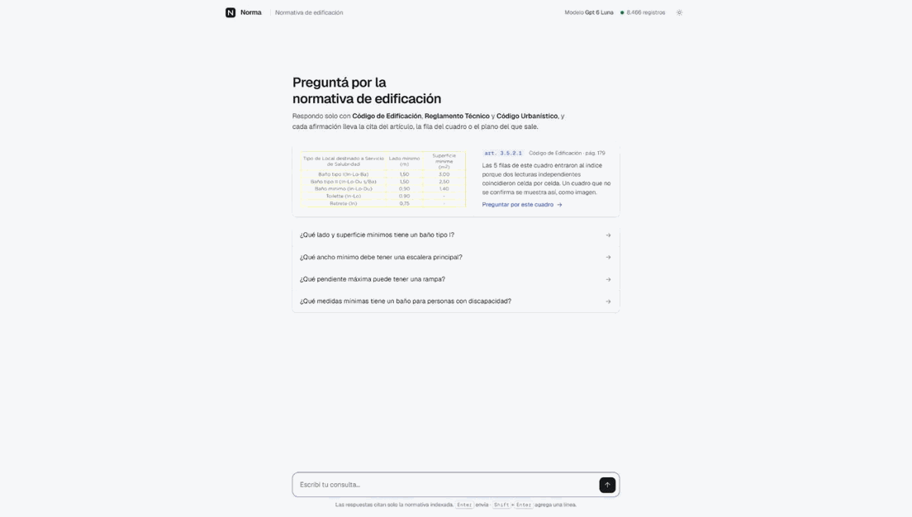
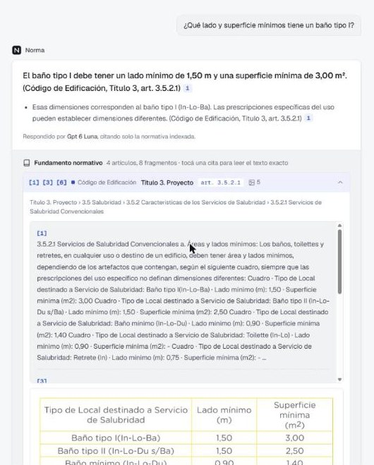
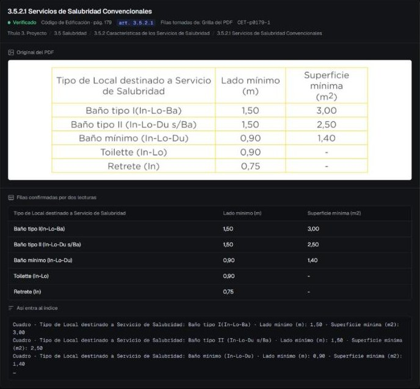
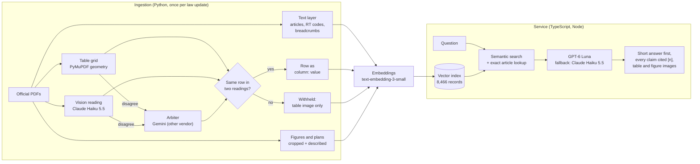
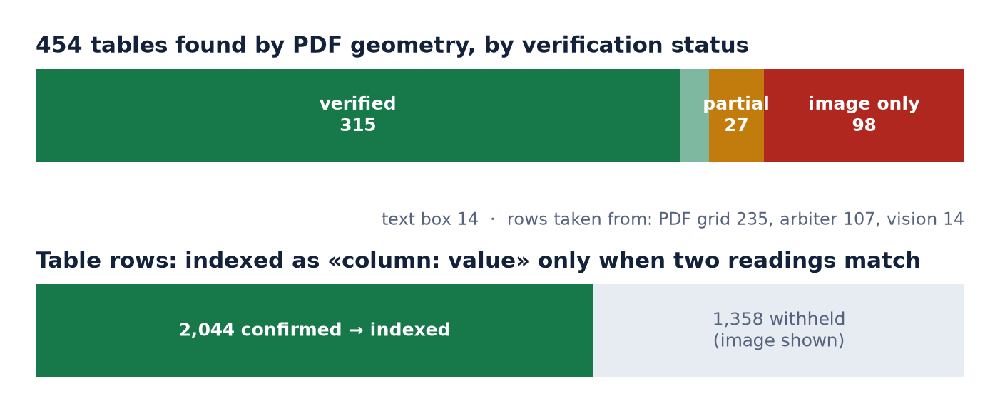
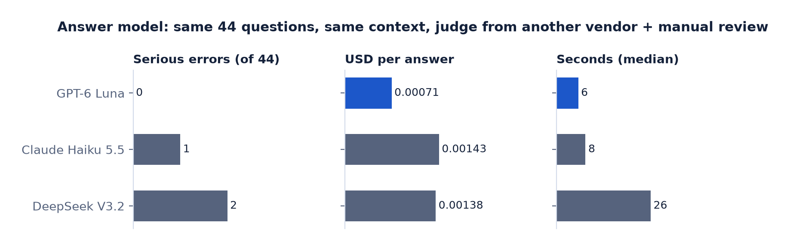
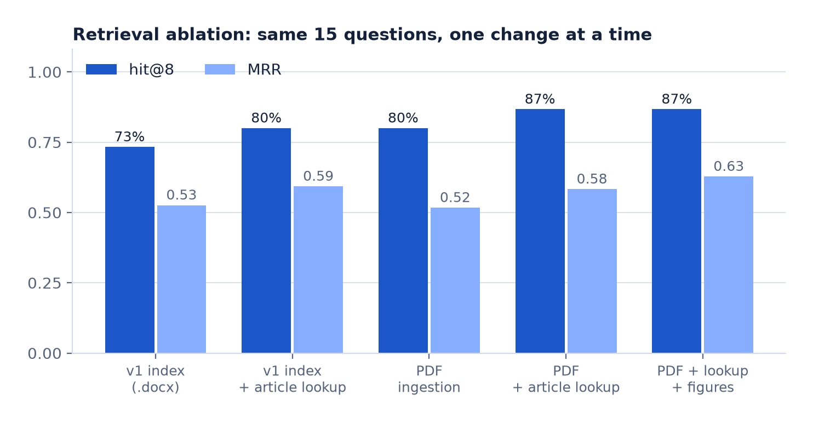
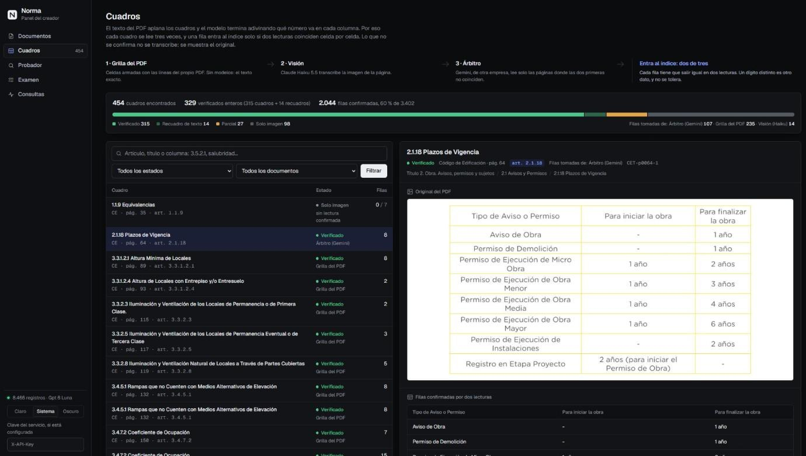
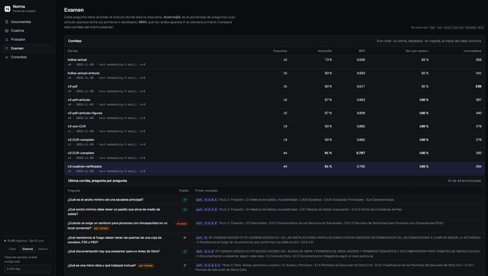

# Norma: a grounded agent for building regulations

[](../../actions/workflows/ci.yml)

Norma answers questions about a city's building and zoning law, in Spanish, and cites the exact article, table row or drawing behind every claim. It runs in production for an architecture and permitting firm, inside the firm's internal platform.

**My role:** I built and run all of it, alone: the ingestion pipeline, the evaluation, the agent server, the creator panel and the deployment, working directly with the firm on what an answer has to look like. Every number below links to the committed run or summary it comes from ([docs/measurements.md](docs/measurements.md)).



*The bathroom table whose columns a model once swapped in production: now read three times, 2,044 of 3,402 table rows confirmed by two independent readings, and the rest withheld instead of guessed. [Try it locally in two minutes](#try-it-in-two-minutes).*

The hard part is not the chat. The hard part is that the law lives in about 3,800 pages of PDF full of multi-level tables, scanned plans and rotated text. A model that reads a table wrong gives a wrong permit answer. This repo is mostly about making the input trustworthy and proving it with measurements.

*The law, the prompts and most code comments are in Spanish, as the users are. Versión en español: [README.es.md](README.es.md)*

## At a glance

| | |
|---|---|
| **Corpus** | 3 bodies of law: the Building Code (CE, 492 pages), the Technical Regulations (RT, 1,462 pages) and the Urban Code (CUR, 10 PDFs, 1,811 pages) |
| **Index** | 8,466 records: article chunks, 514 figures and plans, and table rows written as `column: value` |
| **Tables** | 454 tables found by PDF geometry. 2,044 of 3,402 rows (60 %) confirmed by two independent readings; the rest are withheld and shown as an image ([summary](eval/resultados/tablas-verificacion.json)) |
| **Retrieval** | 44-question exam: right article in the top 8 for 40/44 (91 %), MRR 0.765. Questions written by me from the articles; an architect has not reviewed them yet |
| **Answers** | Model picked on the same 44 questions with a judge from another vendor and manual review: 0 serious errors, USD 0.0007 and 6 s per answer |
| **Cost** | The whole ingestion, experiments included, cost about USD 7 in API calls. Every paid script has a hard spending cap |
| **Production** | Docker on a self-hosted PaaS, API key auth, primary/fallback models from two vendors, query and feedback logs, creator panel |

## See it

| The answer, with its source | The same table in the creator panel |
|---|---|
|  |  |
| «Side 1.50 m, area 3.00 m²» for a type I bathroom: the values a model once swapped ([case study](docs/case-study-tables.md)). Eight retrieved chunks are grouped into four articles, each keeping its citation numbers, with the drawings below. | The table behind that answer: verified by the PDF grid and the vision reading, the original crop, and the exact line that went into the index. |

## How it works



## Engineering decisions, with the evidence

### 1. Tables are verified, not trusted

**The incident.** In production, the answer model said a type I bathroom needs "1.50 m² and a minimum side of 3.00 m". The code says the opposite: side 1.50 m, area 3.00 m². The cause was not the model. The PDF text layer flattens tables (`Lado mínimo mínima (m) (m 2) Baño tipo I 1,50 3,00`), so any model has to guess which number goes with which column. Another model had failed the same way on fire ratings for stair doors.

**The fix.** Each table is read three independent ways:

1. **Grid:** cell boundaries from the PDF's own lines (PyMuPDF), no model involved.
2. **Vision:** Claude Haiku 5.5 transcribes the page image.
3. **Arbiter:** Gemini, a different vendor, reads only the pages where the first two disagree.

A row enters the index only if two readings match cell by cell. Normalization covers decimal commas, superscripts and hyphenated line breaks; a changed digit is never tolerated. Every value carries its column name: `Cuadro · Lado mínimo (m): 1,50 · Superficie mínima (m2): 3,00`. Rows that are not confirmed are **not** written as text. The chunk says the table could not be verified and the UI shows the cropped table image, so the model cannot guess. Chunking never splits a table row.



**Result.** 2,044 rows confirmed and 98 tables left as image only. The retrieval exam did not move (40/44). The two questions that had failed were asked 3 times each to both models: the values were right in all 12 answers (a manual check; those answers were not saved). Cost: USD 0.81 for the vision and arbiter passes ([summary](eval/resultados/tablas-verificacion.json)).

Full write-up, from the production error to the fix: [docs/case-study-tables.md](docs/case-study-tables.md).

The logic and its edge cases are covered by unit tests built from the real failures: swapped columns, rotated text read backwards, merged cells and inherited headers ([`tests/test_cuadros.py`](tests/test_cuadros.py)). Code: [`ingest_v2/tablas_pdf.py`](ingest_v2/tablas_pdf.py).

### 2. Ingest the PDF, not the convenient format

Version 1 indexed the `.docx` versions. They lose structure: no article numbers in headings, no RT codes, tables without a grid. Version 2 reads the official PDFs:

- RT codes come from each page header.
- Article breadcrumbs are chained by number and named with the PDF bookmarks.
- Headers and footers are cut by geometry.
- Signature pages are dropped.

All 736 numbered articles of the Building Code were found in the text (736/736). Code: [`ingest_v2/extraer_pdf.py`](ingest_v2/extraer_pdf.py).

### 3. Every model choice is measured

- **Vision:** 8 models on the same pages, scored automatically against the PDF text layer and a cross-checked table extraction. Claude Haiku 5.5 tied the best on quality, including on the worst page, at 1/12 of the previous model's cost.
- **Answers:** 3 candidates answered the same 44 questions with the same retrieved context. Automatic checks, a judge from a different vendor, and every flagged error checked by hand. GPT-6 Luna had 0 serious errors and was the cheapest and fastest; Claude Haiku 5.5 is the cross-vendor fallback.



Scripts: [`eval/comparar_modelos_vision.py`](eval/comparar_modelos_vision.py) and [`eval/comparar_modelos_respuesta.mts`](eval/comparar_modelos_respuesta.mts).

### 4. An exam gates every change

[`eval/correr-examen.mts`](eval/correr-examen.mts) asks questions whose expected article is known and reports hit@k and MRR. Every result is versioned in [`eval/resultados/`](eval/resultados/):

| Change | Exam | Hit@8 | MRR |
|---|---|---|---|
| v1 index (`.docx`) | v0, 15 q | 11/15 | 0.526 |
| PDF ingestion + exact article lookup + figures | v0, 15 q | 13/15 | 0.628 |
| + Urban Code | v1, 19 q | 17/19 | 0.68 |
| Exam widened to 44 questions | v2, 44 q | 40/44 | 0.767 |
| Verified tables replace flattened text | v2, 44 q | 40/44 | 0.765 |



PDF ingestion alone did not raise MRR: the gain came when the article numbers it recovered were used for exact lookup. Charts are generated from the versioned results by [`eval/graficos.py`](eval/graficos.py).

The 4 remaining misses are documented one by one in [docs/measurements.md](docs/measurements.md#the-4-misses). Two are open questions for an architect, not search failures.

The exam also runs in CI, without API keys. The 10 exam questions whose answer lives in the demo sample are stored with their query vectors already computed ([`demo/examen/`](demo/examen/)), and [`tests/examen-muestra.test.ts`](tests/examen-muestra.test.ts) fails the build if hit@8 or MRR on the sample drops below today's 8/10 and 0.80. It is a regression gate on a small slice, not the headline number above.

### 5. Citations a professional can check

The answer comes first, in one to three sentences. Then the detail, where every claim carries a citation `[n]` to a legal location, never to a file name: "Código de Edificación, art. 3.5.2.1". Figures, plans and table images linked to the cited article are shown next to the answer. The system prompt forbids answering from memory and asks the model to say when the retrieved law does not cover the question.

### 6. Built to be operated

- `/panel` is the creator's panel, with five tabs:
  - **Documents:** chunk explorer per source file.
  - **Tables:** each of the 454 tables with its status, the reading that won, the confirmed rows and the cropped original, plus the exact text that went into the index. Tables that two readings could not confirm form a **review queue**: the reviewer sees the original next to an editable grid, starts from whichever reading agrees best, and every row that no other reading matches is flagged. A confirmed review is appended to a log with the reviewer, the base reading and how many cells were changed, enters the index at the next re-index as a third category (*reviewed by hand*, never counted as confirmed by two readings), and is ignored if the table's geometry changes later.
  - **Tester:** what retrieval returns for a question, without generating.
  - **Exam:** every run, and the latest one question by question.
  - **Queries:** the log of real questions.

| Tables tab | Exam tab |
|---|---|
|  |  |

- Every query and every 👍/👎 is logged.
- Switching the model is an environment variable. The fallback kicks in when the primary fails to start a stream, and it is tested.
- CI runs the type check, the unit tests and the retrieval exam on the demo sample, none of which call an API.
- The jurisdiction is configuration, not code: the city, the names of its codes, how each one is cited and the corpus block of the prompt live in [`jurisdicciones/<id>/`](jurisdicciones/README.md), chosen with `JURISDICCION`. The service refuses to start without one, `/health` reports which one is loaded, and a test holds each jurisdiction to its saved prompt (`prompt.snapshot.txt`), so moving the production one to configuration changed no byte the model sees.

## Honest limits

- The exam questions were written from the articles but not yet reviewed by an architect. The numbers guide decisions; they are not a certification.
- 98 tables could not be confirmed by two readings and are served as images only, plus 27 partly confirmed. This is deliberate: a wrong value is worse than no value. They wait in the review queue for a person who knows the law; none has been reviewed yet.
- The answer-model comparison used one judge and 44 questions.
- The vector store is in memory (about 8,500 records, so cosine search is instant). Moving to pgvector only touches [`src/lib/vector-store.ts`](src/lib/vector-store.ts).

## Repository map

```
ingest_v2/        PDF ingestion (Python): text, tables, figures, Urban Code, indexing
src/              service (TypeScript): retrieval, prompt, generation, HTTP API
  lib/            embeddings, generation with fallback, vector store
public/           chat UI and creator panel (no framework)
jurisdicciones/   city, code names and citation rules: configuration, not code
eval/             exams, model comparisons, versioned results
tests/            unit tests (no API calls)
docs/             measurements, the tables case study, design system, images
demo/             a sample of the real index and `npm run demo`
scripts/          rebuild the demo sample, save a prompt snapshot
```

## Try it in two minutes

The repo ships a small sample of the real index in [`demo/data`](demo/data): the Building Code chapters on exits and stairs (3.4) and on bathrooms (3.5). That is 282 records with their embeddings already computed, plus 15 tables and their original images. No API key is needed to start it:

```bash
npm install
npm run demo                      # chat at http://localhost:8787, creator panel at /panel
```

Without keys the creator panel works: documents, the 15 tables with their readings and the 3 that wait for review, the exam runs and the query log. The Tester answers the sample's 10 exam questions offline, since their vectors are cached; any other question needs an OpenAI key. Reviews made in the demo go to `demo/.local/`, outside the versioned sample. To ask the chat, put an OpenAI key (to embed the question) and an OpenRouter key (for the answer) in `.env.local` (copy `.env.example`), then ask *«¿Qué lado y superficie mínimos tiene un baño tipo I?»* and open the Tables tab. A question costs well under one cent. The sample is rebuilt from a full index with `python -I scripts/muestra.py <index>`.

## Run it on the full corpus

Requires Node 22, Python 3.11+ (`pip install -r requirements.txt`), and API keys for OpenAI (embeddings) and OpenRouter (generation) in `.env.local` (see `.env.example`). The law PDFs and the generated index are not versioned.

```bash
npm install && pip install -r requirements.txt
export JURISDICCION=jurisdicciones/ejemplo          # names of the source PDFs, citation rules

# Tables: three readings, then keep rows two of them agree on (spending caps in USD)
python -I ingest_v2/tablas_pdf.py geometria <pdf folder>
python -I ingest_v2/tablas_pdf.py vision <pdf folder> 0.50
python -I ingest_v2/tablas_pdf.py arbitro <pdf folder> 0.50
python -I ingest_v2/tablas_pdf.py decidir <pdf folder>

# Text and figures of the Building Code and the RT, then the Urban Code
python -I ingest_v2/extraer_pdf.py <pdf folder> data/v2/chunks.jsonl
python -I ingest_v2/extraer_figuras.py <pdf folder> --describir 2.00
python -I ingest_v2/extraer_cur.py <urban code folder> --prosa 0.30 --tablas 0.10 --planos 0.30

npx tsx ingest_v2/indexar.mts normativa_v2          # a new index; never overwrites the one being served
VECTOR_INDEX=normativa_v2 npm run serve             # chat at /, panel at /panel
VECTOR_INDEX=normativa_v2 npx tsx eval/correr-examen.mts eval/examen-v2.json my-label 8
npm test                                            # no API calls
```

## License

Code under the [MIT License](LICENSE). The regulation texts in `demo/data` are public documents.
